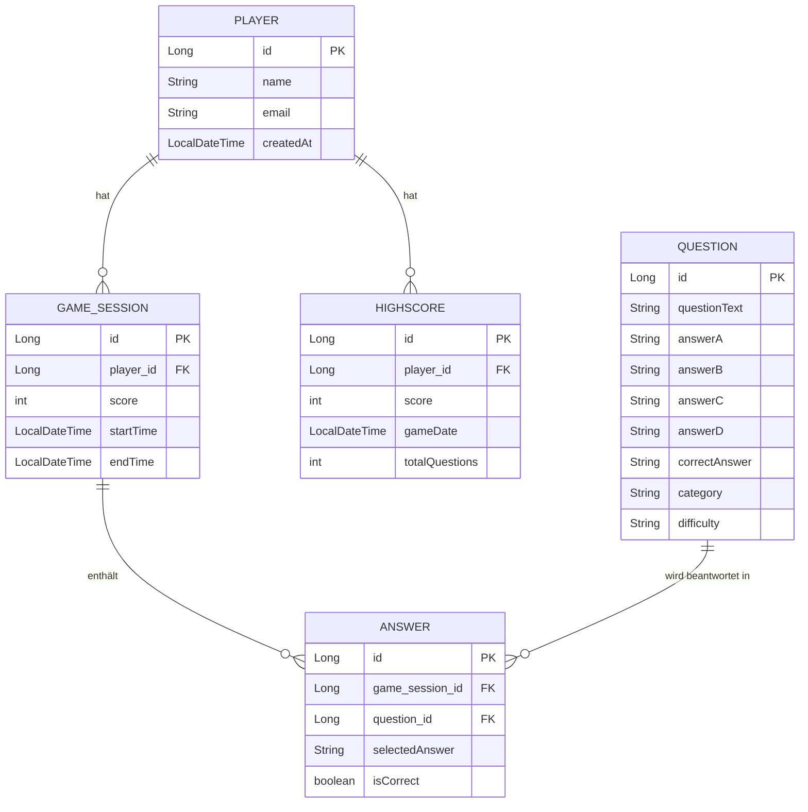
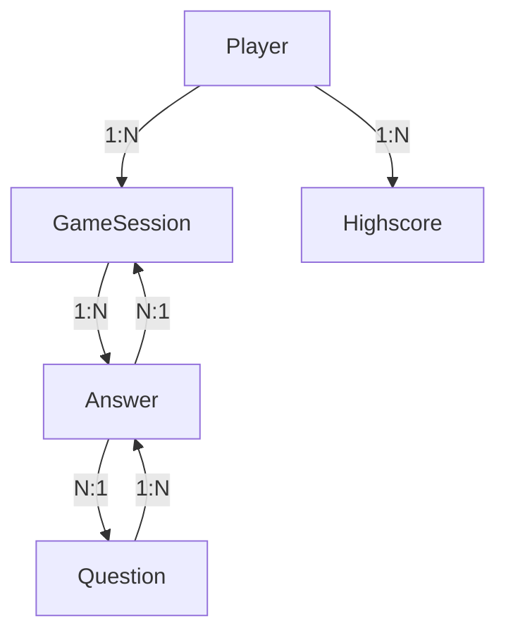

# 🌍 GeographieQuiz — Spring Boot

Ein Geographie-Quiz-Spiel mit Spring Boot, H2-Datenbank, REST-API und Frontend. Das Projekt lehrt Datenbank-Design, JPA/Hibernate, CRUD-Operationen und SQL-Abfragen.

## 📋 Übersicht

Teste dein Wissen über Länder, Hauptstädte, Flüsse, Berge und Kontinente — mit Multiple-Choice-Fragen, Timer, Highscore-Tabelle und Live-Datenbank-Anzeige im Browser.

## 🛠️ Technologie-Stack

| Technologie | Version | Zweck |
|---|---|---|
| Spring Boot | 4.1.2 | Framework |
| Java | 25 | Sprache |
| H2 | In-Memory | Datenbank mit Browser-Konsole |
| Spring Data JPA | 4.1.x | Datenbank-Zugriff |
| Spring Validation | 4.1.x | Datenvalidierung |
| SpringDoc OpenAPI | 3.x | API-Dokumentation (Swagger UI) |
| JUnit 5 | 5.x | Unit- und Integrationstests |
| Thymeleaf | 3.x | Frontend-Templates |

## 🚀 Schnellstart

### Voraussetzungen

- Java 25 installiert
- Maven installiert

### Starten

```bash
cd GeographieQuiz_SpringBoot
mvn spring-boot:run
```

Die Anwendung startet auf `http://localhost:8084`.

### Seiten

| URL | Beschreibung |
|---|---|
| `http://localhost:8084/` | Startseite |
| `http://localhost:8084/quiz` | Quiz-Spiel |
| `http://localhost:8084/highscore` | Highscore-Tabelle |
| `http://localhost:8084/h2-console` | H2-Datenbank-Konsole |
| `http://localhost:8084/swagger-ui.html` | API-Dokumentation |

## 🗄️ H2-Datenbank im Browser

Nach dem Start der Anwendung:

1. Öffne `http://localhost:8084/h2-console`
2. Verbinde mit `jdbc:h2:mem:geographiequiz` (Standard)
3. Siehe alle Tabellen: `question`, `player`, `game_session`, `answer`, `highscore`
4. Führe SQL-Abfragen aus, um die Daten zu verstehen

### Beispiel-Abfragen

```sql
-- Alle Fragen anzeigen
SELECT * FROM question;

-- Fragen nach Kategorie filtern
SELECT * FROM question WHERE category = 'Europa';

-- Highscore-Liste
SELECT h.score, p.name, h.game_date 
FROM highscore h 
JOIN player p ON h.player_id = p.id 
ORDER BY h.score DESC 
LIMIT 10;

-- Spiel-Statistiken
SELECT COUNT(*) as gesamt, 
       SUM(CASE WHEN is_correct = true THEN 1 ELSE 0 END) as richtig,
       SUM(CASE WHEN is_correct = false THEN 1 ELSE 0 END) as falsch
FROM answer;

-- ManyToMany-Beziehung: Alle Antworten einer Session mit Fragen
SELECT g.id AS session_id,
       p.name AS player_name,
       q.question_text,
       a.selected_answer,
       a.is_correct
FROM answer a
JOIN game_session g ON a.game_session_id = g.id
JOIN player p ON g.player_id = p.id
JOIN question q ON a.question_id = q.id
ORDER BY g.start_time DESC;
```

## 📊 Datenbank-Design

### Entity-Relationship-Diagramm (Mermaid)



### Tabellen im Detail

| Tabelle | Beschreibung |
|---|---|
| `question` | Quiz-Fragen mit 4 Antwortoptionen, Kategorie, Schwierigkeit |
| `player` | Spieler-Profile (Name, E-Mail) |
| `game_session` | Spielverlauf (Spieler, Punkte, Start-/Endzeit) |
| `answer` | Einzelne Antworten — **Join-Tabelle** zwischen Session und Frage |
| `highscore` | Top-Ergebnisse (Spieler, Punkte, Datum) |

### Beziehungen im Detail

| Beziehung | Typ | Fremdschlüssel | Beschreibung |
|---|---|---|---|
| Player → GameSession | One-to-Many | `player_id` in `game_session` | Ein Spieler kann viele Spiele spielen |
| Player → Highscore | One-to-Many | `player_id` in `highscore` | Ein Spieler kann viele Highscore-Einträge haben |
| GameSession → Answer | One-to-Many | `game_session_id` in `answer` | Eine Session enthält viele Antworten |
| Question → Answer | One-to-Many | `question_id` in `answer` | Eine Frage kann in vielen Sessions beantwortet werden |
| Answer → GameSession | Many-to-One | `game_session_id` in `answer` | Viele Antworten gehören zu einer Session |
| Answer → Question | Many-to-One | `question_id` in `answer` | Viele Antworten beziehen sich auf eine Frage |

### Die `answer`-Tabelle als Join-Entität

Die `answer`-Tabelle realisiert eine **ManyToMany-Beziehung** zwischen `game_session` und `question`. Im Gegensatz zu einer einfachen Join-Tabelle speichert sie zusätzlich:

| Spalte | Zweck |
|---|---|
| `game_session_id` (FK) | Verweis auf die Spiel-Session |
| `question_id` (FK) | Verweis auf die gestellte Frage |
| `selected_answer` | Gewählte Antwort des Spielers (A, B, C, D) |
| `is_correct` | Ob die Antwort richtig war (true/false) |

**Warum keine direkte `@ManyToMany`-Annotation?**

Eine direkte `@ManyToMany`-Beziehung kann nur die IDs verknüpfen. Da zusätzlich `selected_answer` und `is_correct` gespeichert werden müssen, wird eine **Join-Entität** (`Answer`) verwendet. Dies gibt volle Kontrolle über die Beziehung und ermöglicht Abfragen wie "Welche Fragen wurden falsch beantwortet?".

### Beziehungs-Diagramm (vereinfacht)



## 🔌 API-Endpunkte

| Methode | Pfad | Beschreibung |
|---|---|---|
| GET | `/` | Startseite |
| GET | `/quiz` | Quiz-Spiel-Seite |
| GET | `/highscore` | Highscore-Tabelle |
| GET | `/api/questions` | Alle Fragen |
| GET | `/api/questions?category=Europa` | Fragen nach Kategorie |
| GET | `/api/questions?difficulty=easy` | Fragen nach Schwierigkeit |
| POST | `/api/quiz/start` | Spiel starten |
| POST | `/api/quiz/answer` | Antwort abgeben |
| GET | `/api/quiz/status/{id}` | Spiel-Status |
| POST | `/api/quiz/end/{id}` | Spiel beenden |
| GET | `/api/players` | Alle Spieler |
| POST | `/api/players` | Spieler erstellen |
| GET | `/api/players/highscore` | Top-10 Highscore |
| GET | `/h2-console` | H2-Datenbank-Konsole |
| GET | `/swagger-ui.html` | API-Dokumentation |

### Spiel-Flow

1. **Spieler erstellen**: `POST /api/players` mit `{ "name": "Max", "email": "max@test.ch" }`
2. **Spiel starten**: `POST /api/quiz/start` mit `{ "playerId": 1, "questionCount": 10 }`
3. **Antwort abgeben**: `POST /api/quiz/answer` mit `{ "sessionId": 1, "questionId": 5, "selectedAnswer": "A" }`
4. **Spiel beenden**: `POST /api/quiz/end/1`

## 📁 Projektstruktur

```
src/main/java/com/geographiequiz/
├── GeographieQuizApplication.java      # Hauptklasse
├── config/
│   └── WebConfig.java                  # Swagger UI + H2-Konsole
├── entity/
│   ├── Question.java                   # Quiz-Frage
│   ├── Player.java                     # Spieler
│   ├── GameSession.java                # Spiel-Session
│   ├── Answer.java                     # Antwort (Join-Tabelle)
│   └── Highscore.java                  # Highscore-Eintrag
├── repository/
│   ├── QuestionRepository.java         # Fragen-Queries
│   ├── PlayerRepository.java           # Spieler-Queries
│   ├── GameSessionRepository.java      # Session-Queries
│   └── HighscoreRepository.java        # Highscore-Queries
├── service/
│   ├── QuizService.java                # Fragen laden, Antwort prüfen
│   ├── PlayerService.java              # Spieler + Highscore
│   ├── GameSessionService.java         # Session-Management
│   └── DataInitializer.java            # 150 Fragen beim Start laden
└── controller/
    ├── PageController.java             # Thymeleaf-Seiten
    ├── QuestionController.java         # Fragen CRUD
    ├── PlayerController.java           # Spieler CRUD
    ├── QuizController.java             # Spiel-Endpunkte
    └── GlobalExceptionHandler.java     # 404, 400, 500

src/main/resources/
├── application.properties              # H2, Port, Swagger
├── templates/
│   ├── index.html                      # Startseite
│   ├── quiz.html                       # Quiz-Spiel
│   └── highscore.html                  # Highscore-Tabelle
└── static/css/
    └── style.css                       # Design
```

## 🎯 Lernziele

| Ziel | Wie? |
|---|---|
| **Datenbank-Design verstehen** | Entitäten mit Beziehungen erstellen |
| **JPA/Hibernate nutzen** | `@Entity`, `@Repository`, `@Query` |
| **SQL-Abfragen schreiben** | SELECT, JOIN, WHERE, ORDER BY, GROUP BY |
| **H2-Konsole verwenden** | Daten im Browser live ansehen |
| **CRUD-API bauen** | REST-Endpunkte für alle Operationen |
| **Daten validieren** | `@Valid`, `@NotNull`, `@Size` |
| **Tests schreiben** | Unit- und Integrationstests |

## Geographie-Fragen (Beispiele)

| Kategorie | Frage | Antwort A | Antwort B | Antwort C | Antwort D | Korrekt |
|---|---|---|---|---|---|---|
| Europa | Hauptstadt von Frankreich? | Berlin | London | Paris | Madrid | C |
| Europa | Welche Flagge zeigt einen roten Stern auf blauem Grund? | Serbien | Nordmazedonien | Kroatien | Slowenien | B |
| Europa | Welches Land grenzt an die meisten anderen Länder in Europa? | Deutschland | Polen | Ukraine | Russland | A |
| Asien | Größter Fluss in China? | Jangtsekiang | Gelber Fluss | Mekong | Huangho | A |
| Asien | Welches Land hat eine rote Sonne auf weißem Grund? | Japan | Südkorea | Philippinen | Indonesien | A |
| Asien | Welches asiatische Land hat die meisten Einwohner? | Indien | China | Indonesien | Pakistan | A |
| Afrika | Höchster Berg in Afrika? | Kilimandscharo | Mount Kenya | Rwenzori | Atlas | A |
| Afrika | Welches Land hat etwa 220 Millionen Einwohner? | Nigeria | Äthiopien | Indonesien | Brasilien | A |
| Amerika | Längste Bergkette? | Alpen | Himalaya | Anden | Rocky Mountains | C |
| Amerika | Welche Flagge zeigt einen Adler, eine Schlange und einen Kaktus? | Mexiko | Guatemala | Honduras | El Salvador | A |
| Ozeanien | Größte Stadt in Australien? | Melbourne | Sydney | Brisbane | Perth | B |
| Ozeanien | Welches Land hat die Flagge mit dem Union Jack und dem Southern Cross? | Australien | Neuseeland | Fidschi | Papua-Neuguinea | A |

## 🧪 Tests

```bash
# Alle Tests ausführen
mvn test

# Kompilieren
mvn compile

# Anwendung starten
mvn spring-boot:run
```

## Kategorien und Frage-Typen

Das Quiz umfasst **150 Fragen** in 5 Kontinenten, 4 Frage-Typen und 3 Schwierigkeitsgraden.

### Kontinente

| Kontinent | Anzahl Fragen |
|---|---|
| Europa | 30 |
| Asien | 30 |
| Afrika | 30 |
| Amerika | 30 |
| Ozeanien | 30 |

### Frage-Typen

| Typ | Beschreibung | Beispiel |
|---|---|---|
| Hauptstädte | Hauptstadt eines Landes erraten | "Was ist die Hauptstadt von Japan?" |
| Flaggen | Flaggen-Merkmale zuordnen | "Welche Flagge zeigt einen roten Stern auf gelbem Grund?" |
| Angrenzende Länder | Nachbarländer identifizieren | "Welches Land grenzt an Deutschland, Frankreich und die Schweiz?" |
| Einwohnerzahlen | Bevölkerungsgrößen schätzen | "Welches Land hat etwa 83 Millionen Einwohner?" |

### Schwierigkeitsgrade

| Grad | Beschreibung |
|---|---|
| Easy | Bekannte Fakten, große Länder und Hauptstädte |
| Medium | Spezifischere Fragen, Flaggen und Grenzen |
| Hard | Detaillierte Kenntnisse, kleine Länder, exakte Zahlen |

**Gesamt: 150 Fragen** in 3 Schwierigkeitsgraden (easy, medium, hard)

## ⚙️ Konfiguration

In `application.properties`:

| Eigenschaft | Wert | Beschreibung |
|---|---|---|
| `server.port` | `8084` | Server-Port |
| `spring.datasource.url` | `jdbc:h2:mem:geographiequiz` | H2 In-Memory DB |
| `spring.h2.console.enabled` | `true` | H2-Konsole aktivieren |
| `spring.jpa.hibernate.ddl-auto` | `update` | Tabellen automatisch erstellen |
| `spring.jpa.show-sql` | `true` | SQL-Abfragen in der Konsole anzeigen |

## 📄 Lizenz

Dieses Projekt wurde als Lernprojekt für CAS OOP erstellt.
